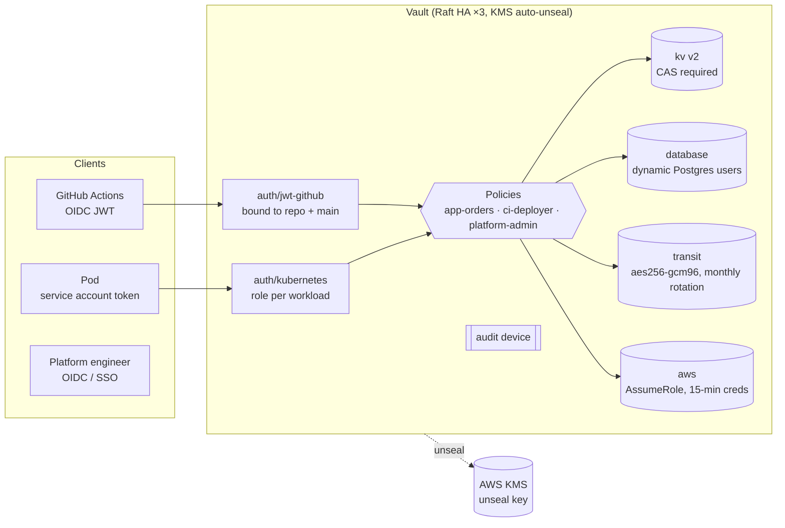

# vault-secrets-patterns

[](https://github.com/vince-sre/vault-secrets-patterns/actions/workflows/ci.yml)


HashiCorp Vault managed entirely as code. It includes least-privilege policies; KV v2, transit, dynamic database credentials and AWS STS engines; Kubernetes and GitHub Actions JWT auth; an audit device; an HA Raft server config with AWS KMS auto-unseal; and three ways for Kubernetes workloads to consume secrets. **An integration test applies all of it to a real Vault dev server in CI and checks every policy boundary.**

It's a personal reference implementation of the secrets-management patterns I've used in production with Vault and AWS KMS. All ARNs, hosts and account IDs are placeholders.

## Architecture



## How workloads get secrets

| Pattern | Path | When I use it |
|---|---|---|
| **Vault Agent injector** | `kubernetes/agent-injector/` | Dynamic DB credentials that have to be renewed during the pod's life; apps that read files |
| **Vault Secrets Operator** | `kubernetes/vault-secrets-operator/` | Teams that want native `Secret`s plus automatic rollout restarts when values change |
| **External Secrets Operator** | `kubernetes/external-secrets/` | One API across Vault, AWS Secrets Manager, GCP and Azure (matches [gitops-argocd-platform](https://github.com/vince-sre/gitops-argocd-platform)) |

## Policy boundaries (checked in CI)

`scripts/integration-test.sh` starts `vault server -dev`, runs `terraform apply`, and checks:

| Token | Can | Cannot |
|---|---|---|
| `app-orders` | read `kv/data/apps/orders/*`, get DB creds, encrypt/decrypt with the `orders` transit key | read other apps' secrets, read or export transit keys, touch `sys/` |
| `ci-deployer` | get 15-minute AWS STS credentials, read `kv/data/ci/*` | read any application secret |
| `platform-admin` | manage mounts, auth methods and policies | **read secret values** (explicit `deny` on `kv/data/*`) |

It also checks that KV writes without check-and-set are rejected, that a transit round trip returns the original plaintext, and that the audit log is recording.

## Design decisions

- **Identity-based auth only.** Pods use their Kubernetes service account, bound to namespace and SA name with a `vault` audience. CI uses GitHub's OIDC token, bound to `vince-sre/*` on `refs/heads/main`. No Vault tokens or AWS keys are stored anywhere.
- **Dynamic over static.** Database users and AWS credentials are created on demand with short TTLs and revoked when the lease ends, so a leaked credential expires on its own.
- **Encryption as a service.** Apps send plaintext to `transit/encrypt` and store ciphertext. The key never leaves Vault (`exportable = false`, `deletion_allowed = false`) and rotates monthly, while old versions stay decryptable.
- **CAS on KV.** Every write has to name the version it replaces, which prevents lost updates between two writers.
- **Operators can't read secrets.** Admins manage configuration; reading values is a separate, audited break-glass path. One caveat: anyone who can edit auth roles could, in principle, bind themselves to a workload policy. That's why all changes go through Terraform PRs and every request is audited.
- **KMS auto-unseal plus Raft.** No manual unseal after a restart or node replacement, and no external storage backend to run.

## How to run

```bash
# Local, no cloud: dev server + full assertions
./scripts/integration-test.sh            # needs vault, terraform, openssl

# Against a real cluster
export VAULT_ADDR=https://vault.example.internal:8200
vault login -method=oidc
cd terraform && terraform init && TF_VAR_db_admin_password=... terraform apply
```

## What this demonstrates

- Vault architecture and operations (HA Raft, auto-unseal, audit)
- Least-privilege policy design that's tested, not just written
- Dynamic secrets, encryption as a service and short-lived cloud credentials
- Kubernetes secret delivery trade-offs (injector vs. VSO vs. ESO)
- Removing long-lived credentials from CI with OIDC federation

## License

MIT
